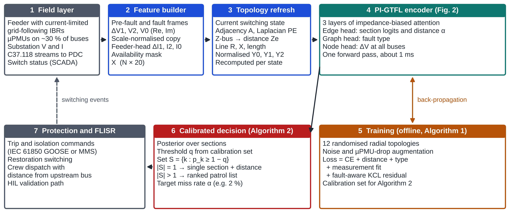

# PI-GTFL: Physics Informed Graph Transformer for Fault Location in Inverter Dominated Distribution Grids

Code, trained weights and results for the article

> S. Marisargunam and G. Arul Dalton, *Physics Informed Graph Transformer for Fault Location in Inverter Dominated Distribution Grids*, submitted to **Electrical Engineering** (Springer), 2026.

PI-GTFL locates short-circuit faults in distribution feeders with current-limited, grid-following inverter-based resources (IBRs) from sparse micro-phasor measurement units (µPMUs). It returns the faulted section, the distance along it and the fault type, and Algorithm 2 converts the output into a calibrated set of candidate sections with a bounded miss rate.



## Main results (IEEE 33-bus feeder, 5000 test faults, TVE 0.5 %)

| Method | Section accuracy | Mean error |
|---|---|---|
| Impedance, Takagi-type, oracle lateral | 60.0 % | 1.108 km |
| GCN | 75.1 % | 0.548 km |
| CNN | 89.1 % | 0.229 km |
| **PI-GTFL** | **91.4 %** | **0.204 km** |

* With 500 training faults, the impedance-biased attention adds **+5.4 points** of section accuracy.
* On **four unseen reconfigured feeders**, topology-randomised PI-GTFL reaches **69.3 %** (0.77 km), against 52.6 % without the physics components and 49.3 % for the oracle impedance method.
* **Algorithm 2** (calibrated fault-section sets, α = 2 %) covers the faulted section in **98.5 %** of faults, with 1.28 sections on average.
* Inference takes about **1 ms** on one CPU thread.

All numbers are in `results/*.json`.

## Repository layout

```
src/        simulator, autodiff engine, models, training, evaluation and figure scripts
  sim.py          phasor-domain sequence-network fault simulator with current-limited IBRs
  ag.py           minimal reverse-mode automatic differentiation (NumPy), gradient-checked
  models.py       features, PI-GTFL, GCN, CNN, KCL physics loss, Takagi-type impedance baseline
  topo.py         topology library (12 training + 4 unseen radial configurations)
  gen.py / gen_topo.py          dataset generation (fixed seeds)
  train.py / train_topo.py      training (Algorithm 1), base and topology-randomised
  evaluate.py / eval_topo.py    Tables 3-5 and Figs. 4-5
  conf_eval2.py                 Algorithm 2 (calibrated fault-section sets), Table 6
  fig_journal.py                Figs. 1-5 (600 dpi PNG and TIFF)
weights/    trained weights for every model and seed reported in the paper
results/    raw result files behind every table and figure
figures/    article figures
scripts/    run_all.sh (full reproduction), eval_pretrained.sh (evaluate released weights)
```

## Quick start

```bash
git clone https://github.com/iitrky/PI-GTFL.git
cd PI-GTFL
pip install -r requirements.txt
bash scripts/eval_pretrained.sh     # regenerate data from seeds and evaluate the released weights (~30-45 min)
bash scripts/run_all.sh             # reproduce everything from scratch (~6-8 CPU-hours)
```

Only NumPy, SciPy, NetworkX, Matplotlib and Pillow are required. No deep-learning framework is needed.

## Train a single model

```bash
cd src
python3 gen.py                      # base-topology datasets
python3 train.py pigtfl 25 0        # variant, epochs, seed  (optional 4th argument: number of training faults)
python3 evaluate.py
```

Variants: `pigtfl`, `gt_nophys` (without KCL loss), `gt_nobias` (without impedance bias), `gt_measonly`, `gt_vanilla`, `gcn`, `cnn`.

## Scope and limitations

The simulator is phasor-domain and sequence-based: transposed lines, balanced loads, no electromagnetic transients, and grid-following inverters only. Results are for the IEEE 33-bus feeder. Hardware-in-the-loop validation is future work. See Sect. 6.6 of the article.

## Citation

See `CITATION.cff`. Please cite the article once it is published.

## License

MIT, see `LICENSE`.
